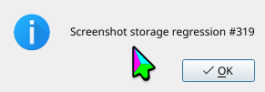

# Screenshot storage recovery (#319)

## Cause and change

The old PNG-save recovery did not cover `active_window_info`: its temporary
KWin script was written in the runtime workdir before capture started. With
no space left, that script write returned a raw I/O error. `inline=true` and
`window_list` both depended on the same runtime script storage.

New sessions store these scripts in the disk twin and expose them to KWin
through a read-only runtime mount. The existing PNG error and inline recovery
paths remain reachable when the runtime filesystem is completely full.
Script-write failures also gain path and storage diagnostics. Restored older
sessions keep the original script location because their mount namespace does
not contain the new mount.

## Real-system result (engi, 2026-10-15)

The check used the production stdio entrypoint, a 1440x900 isolated desktop,
and a static KDialog. Three screenshots succeeded before filling the runtime
filesystem. The test HOME was empty and private, and its host D-Bus proxy
denied wallet and Secret Service access.

The wrapper mounts a bounded private tmpfs using `sudo -n unshare --mount`,
then runs the check with the original UID and groups. Only the private mount
is filled; the host's shared `/tmp` quota and mount namespace are unchanged.
It requires passwordless sudo for that mount setup.

- Original `3dffc297323aa8e25d0334d4c76492d94900dba1` binary: the regression
  failed as expected at the missing `write_failed` assertion. The screenshot
  returned raw `No space left on device (os error 28)` ([response](baseline-error.json)).
- Candidate: **1 passed, 0 failed**, 52 filtered out, in 2.66 seconds.
  The default screenshot returned the recoverable storage error
  ([response](storage-error.json)); [window inspection](windows.json) still
  worked; two inline captures returned complete PNGs with `path: null` and
  [write diagnostics](inline.json). No screenshot or partial file remained.
- Releasing the fill file restored normal screenshot saving. Session stop
  removed both the runtime workdir and disk twin. The script directory was
  empty after all inspection calls.
- The launch command also required that the sandbox could not write the
  `kwin-scripts` directory.

Commands:

```bash
bash tests/screenshot_storage_e2e.sh target/kwin-mcp-319-baseline artifacts/session_lifecycle_e2e target/proof-baseline-full2
bash tests/screenshot_storage_e2e.sh artifacts/kwin-mcp artifacts/session_lifecycle_e2e target/proof-candidate
```

Original binary SHA-256 (debug info stripped):
`896e8e9eb67bba8803d1e25cc3e2dae0b3a6625fb73ad3ef8fb84fb293c3bb0c`.
Candidate binary SHA-256 (debug info stripped):
`672724a53a8f4fa8346e9ffad4c9a4ada0d03f6839b324a9526eca7bdd66545d`.
Candidate `src/main.rs` SHA-256:
`722a532267e18249830b520d13482475a5bef54457d1be9e2fa452743ff8e0ac`.

## Images

Original binary before capacity was exhausted:


Candidate inline capture at zero free bytes:



Candidate saved capture after space was released:


All three images were independently inspected and show the expected dialog.

## Build and checks

Builds ran on sentry through `/home/nate/claude/luna/build-slot`, transported
with `dsh build --host sentry`:

- `cargo build --bin kwin-mcp --jobs 2`: original binary passed (6m 16s).
- `cargo build --jobs 2`: candidate, all binaries passed (5m 13s).
- `cargo test --test session_lifecycle_e2e --no-run --jobs 2 --message-format=json`:
  runner compiled (11.31s).
- `cargo clippy --all-targets --jobs 2`: passed (2m 48s), with the existing
  `collapsible_if` warning in the viewer PipeWire lifecycle case, now at
  `tests/session_lifecycle_e2e.rs:6492`.
- `rustfmt --edition 2024 --config skip_children=true --check src/main.rs tests/session_lifecycle_e2e.rs`:
  passed.
- `bash -n tests/screenshot_storage_e2e.sh` and `git diff --check`: passed.
- `cargo fmt --all -- --check`: exits 1 for existing differences in
  `src/bin/kwin-viewer.rs` and `src/input_bridge.rs`; neither file is changed.

Not verified: a completely exhausted real per-user `EDQUOT` limit, or a live
upgrade of a pre-change desktop. The private runtime check exercises `ENOSPC`.
The existing ignored user-quota regression remains available and unchanged.
