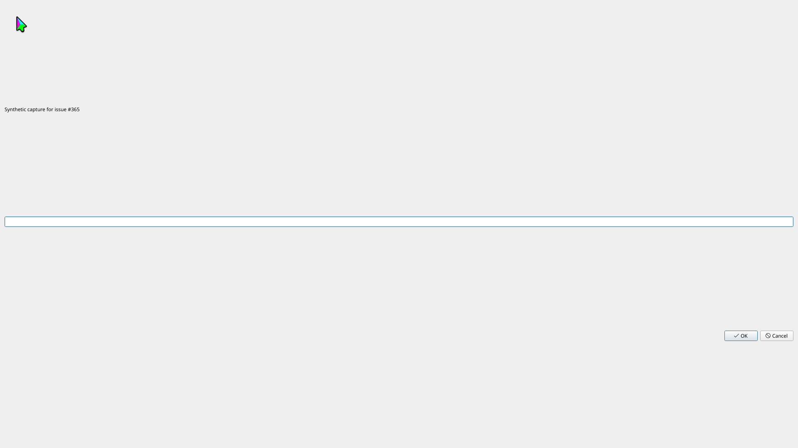

# Screenshot metadata regression evidence

The captures below use a synthetic KDialog in a private 1920×1080 desktop on
KWin 6.7.5. The server and application use a private HOME; the host desktop and
browser profiles are not used for this proof.

| Default branch (`3dffc29`) | With the fix |
| --- | --- |
|  |  |

The two independently captured PNGs are byte identical (SHA-256
`10cb8b03bc897efce3b6600ae2b612c849e4186ad168156e31bd6e769cd2bc6d`).
The baseline response has only `content` and `isError`; the fixed response also
has `structuredContent`.

Run the regression script against an already built server:

```bash
ruby tests/screenshot_metadata_e2e.rb /path/to/kwin-mcp /path/to/evidence
```

On the default branch, the file capture passes, then the full inline capture
fails with `key not found: "structuredContent"`. Its PNG still arrives in the
image block; `before.png` was decoded from that response's base64 image.

With the fix, all six cases pass: file, full inline, cropped inline, cursor
inline, inline with a failed file save, and a recovered file save. The script
checks that inline metadata equals its JSON text block, verifies PNG dimensions
against metadata, and compares each saved inline PNG byte for byte with its
image block. It also independently checks the fixture through `window_list`.

The save failure is induced by placing an empty directory at this private
session's screenshot destination. No quota or shared filesystem permissions
are changed. The response retains the PNG and reports `path: null` and
`write_error` in both metadata representations.

Client-specific image rendering in Claude Code was not checked.
