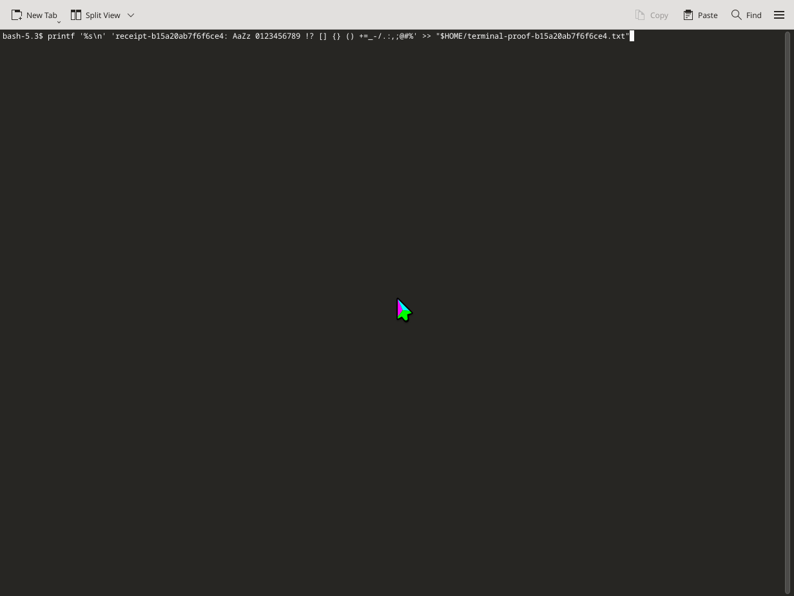
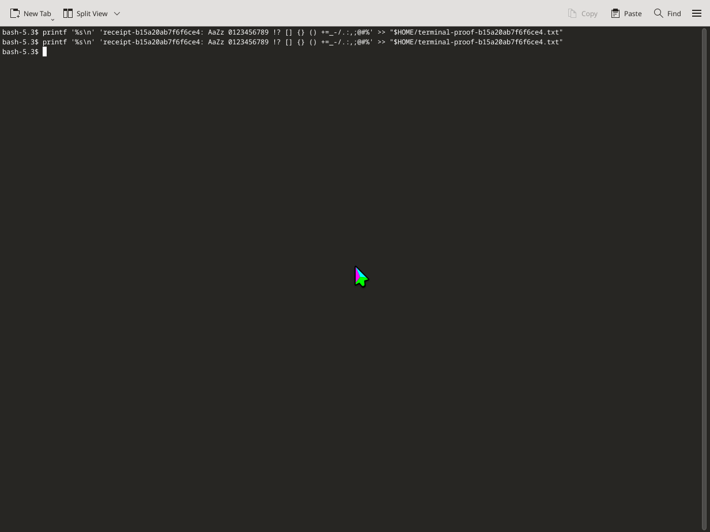
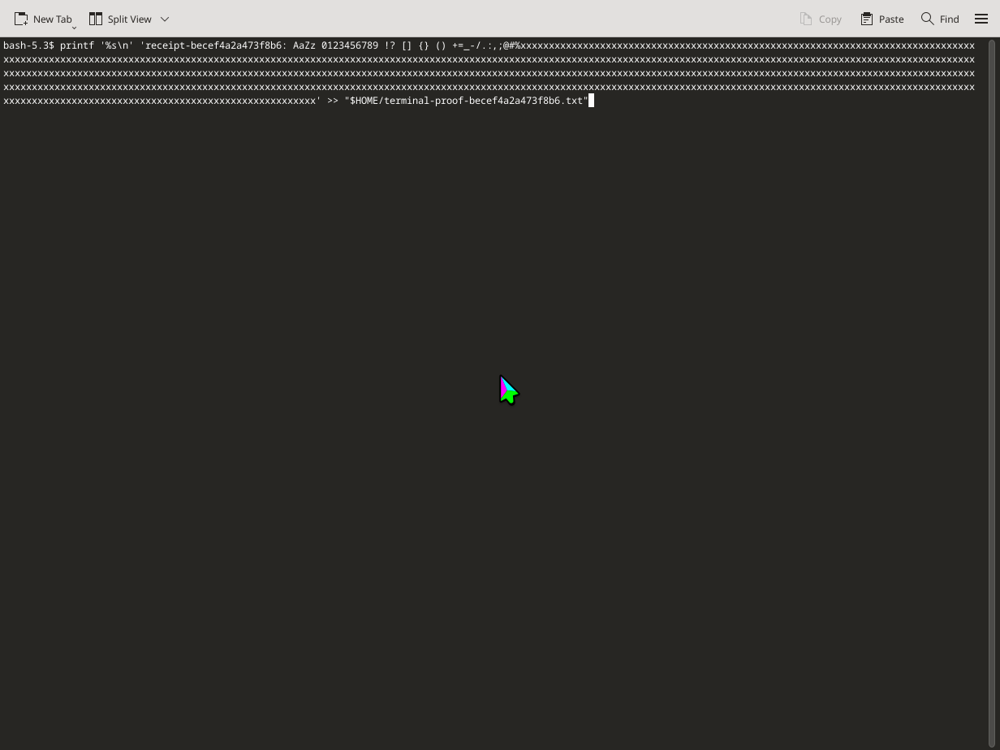
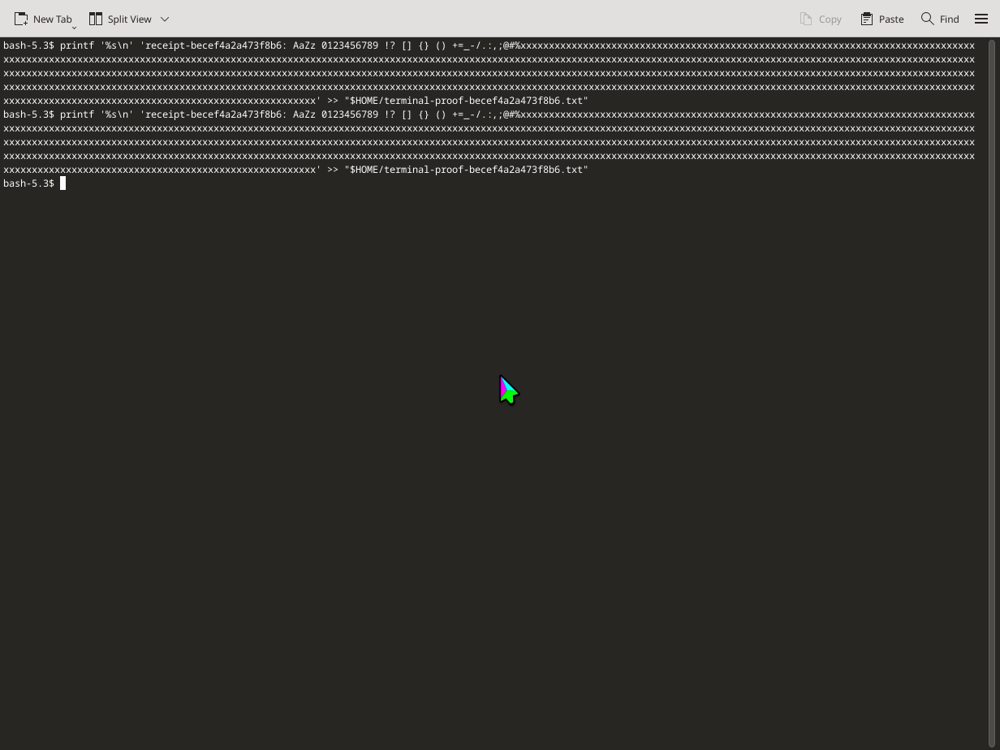

# Terminal input receipts and independent verification

A terminal can receive every submitted key while exposing no editable text through AT-SPI. Treat the receipt as evidence about input submission and compositor acknowledgement. Verify the command's effect separately before repeating it.

## Read the receipt

For the observed focused Konsole, production `keyboard_type` returns:

| Field | Observed value | Meaning |
| --- | --- | --- |
| `submission_complete` | `true` | All requested characters were submitted. |
| `submitted_characters` | Requested character count | Count of submitted characters. |
| `delivery.method` | `terminal` | The focused surface was recognized as a terminal. |
| `delivery.compositor_acknowledged` | `true` | KWin acknowledged the input events. |
| `delivery.status` | `unverified` | Terminal contents were not read back through AT-SPI. |
| `retry_safe` | `false` | Repeating input can duplicate the command. |
| Field character counts | `null` | No editable-field comparison was invented. |

`submission_complete` does not mean a shell command executed. The observation sends a separate Return only after inspecting the pending command. Compositor acknowledgement also does not prove application delivery. A terminal receipt marked `unverified` is compatible with a successfully delivered command; it is not a reason to retype it.

This distinction addresses #411 and #467. The same receipt checks cover the 777-character input size reported in #405, but its default-typing latency concern remains open.

## A faster existing route for bulk text

Activate the exact owned Konsole and confirm its focused terminal surface. For text without a trailing newline:

1. Call `clipboard_write` with `target: "session"` and the command text.
2. Send `keyboard_key` with `key: "ctrl+shift+v"` for Konsole's native paste action.
3. Inspect the pending command in a screenshot.
4. Send Return once when execution is intended.
5. Verify the expected result independently.

The clipboard receipt establishes stored text and length. The paste-key receipt establishes the shortcut operation. Neither claims verified application text. This sequence uses the isolated session clipboard. Other terminals may use different shortcuts, and multiline clipboard contents may be interpreted by the application.

For these controlled observations, the shell appended a random nonce and known printable payload to a dedicated file. `export_file` copied that file out and compared its bytes. After the typed trial there was exactly one payload line; after a distinct, intentional paste trial there were exactly two identical lines. No input was retried.

For real work, use the command's appropriate read-only result check. A visible prompt alone does not establish successful execution.

## Observed production behavior

The fixture drove the built `kwin-mcp` stdio entrypoint at `05b937d1c2ce50c52b80c878e0d1c12555a3ef44` on engi, Linux `7.2.9-arch1-1`, KWin `6.8.0`. Each run used a fresh dedicated HOME, normal bounded session startup, fresh browser profiles and one owned Konsole.

| Input | Default typing RPC | Session clipboard plus paste | First exact export | Export after second trial |
| --- | ---: | ---: | ---: | ---: |
| 129 characters | 16.505 s | 0.280 s | 67 bytes | 134 bytes |
| 777 characters | 71.904 s | 0.382 s | 715 bytes | 1,430 bytes |

These are observations of the committed payloads, not latency guarantees. The long payload includes repeated `x` characters. Its timing must not be compared with the historical 99-second report as evidence of a default-speed change. This PR changes documentation and regression coverage; default character pacing is unchanged.

Each run made one `keyboard_type` call, one session clipboard write and three key calls: Return, paste, Return. Both reported the receipt above, preserved the active owned window, produced exact expected file bytes, stopped their session and removed the session workdir.

The separate faster-input work in #566 and #568 concerns #476. This packet does not claim to implement or replace it.

## Reproduce

Build the production server, then run from the logged-in non-root KDE host environment with its normal user runtime and service manager:

```sh
cargo build --locked --offline -j1 --bin kwin-mcp
ruby tests/terminal_receipts_e2e.rb target/debug/kwin-mcp /tmp/terminal-receipts-short 129
ruby tests/terminal_receipts_e2e.rb target/debug/kwin-mcp /tmp/terminal-receipts-long 777
```

Choose fresh output paths. The fixture preserves inherited runtime and bus overrides; unset values use the server's validated host defaults. Do not run this server-starting fixture inside a desktop created by `launch_app`: it deliberately lacks the host bus and cannot supply the required user service scope.

The fixture stores the RPC trace, raw receipt, focused-terminal accessibility state, exact command and payload, independent outputs, timing summary and screenshots. Assertions distinguish submission from application verification and reject missing, changed or duplicate output. Cleanup runs after success or failure.

An initial nested-desktop attempt was rejected before input because the host runtime was unavailable. A first host invocation was stopped by the command tool's short timeout before input; its owned server and launcher were confirmed absent. The completed host runs below are the acceptance evidence.

## Evidence

- [Build and fixture identity](verification/terminal-receipts/build-manifest.json)
- [129-character verification](verification/terminal-receipts/short/verification.json), [receipt](verification/terminal-receipts/short/typing-receipt.json), [RPC trace](verification/terminal-receipts/short/rpc.jsonl)
- [777-character verification](verification/terminal-receipts/long/verification.json), [receipt](verification/terminal-receipts/long/typing-receipt.json), [RPC trace](verification/terminal-receipts/long/rpc.jsonl)





