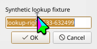
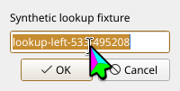
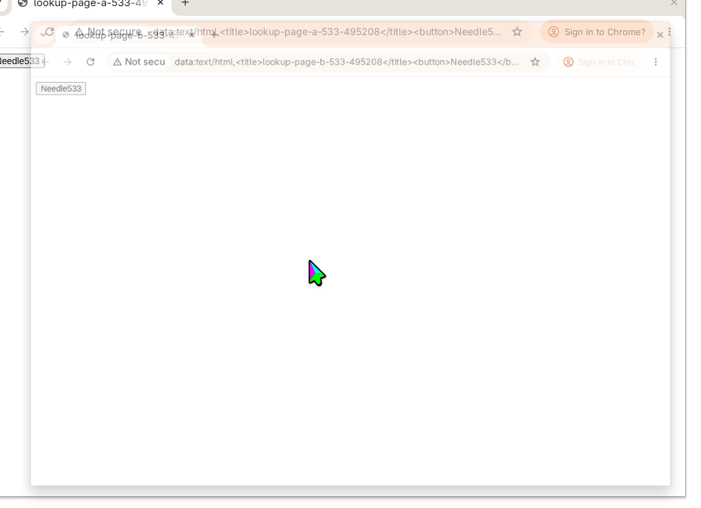

# UI match sources and coordinate frames

This observation addresses issue #533 through the requested source/frame metadata and fresh-snapshot guidance. It preserves the existing search across exposed pages or accessibility applications.

## Reproduce

On a KDE host, build the production binaries, then run:

```sh
cargo build --locked --bins -j1
ruby tests/ui_match_sources_e2e.rb /absolute/path/to/kwin-mcp /absolute/path/to/evidence
```

The runner uses a private HOME and starts its own desktop through production MCP stdio. It opens two KDialog windows with identical OK buttons, activates the left window, observes the named source and its bounds, and clicks its OK button. It independently verifies that the left window closes while the right one remains. It then opens two fresh Chrome windows with the same `Needle533` label on different synthetic data pages and verifies their distinct page/target identities. No signed-in profile is used. The owned session stops in the cleanup block.

## Before

Unchanged master `05b937d1c2ce50c52b80c878e0d1c12555a3ef44` returned the [raw match results](before-matches.json) without structured element sources or coordinate-frame labels. The same regression exited 1 at the missing `elements` key. This is a metadata failure; it does not assert that the baseline pixels are visibly wrong.



## After

The [native result](after-native-matches.json) identifies each application's bus/object identity and each top-level surface's name, identity, and reported bounds. It separately identifies the KWin window observed before and after traversal. The [browser result](after-browser-matches.json) identifies both CDP target IDs, titles, and URLs and labels their bounds as `page_viewport_css`.

The real native run exposed a further ambiguity: Qt on Wayland returned a top-level origin of `(0,0)` even though AT-SPI was asked for Screen coordinates and KWin placed the window elsewhere. The response therefore calls these bounds `atspi_screen_reported` and explicitly says their global origin is unverified. It no longer instructs callers to subtract the KWin window origin blindly. In this fixture, the runner checked the surface dimensions against the screenshot and used bounds relative to the identified AT-SPI surface; the resulting GUI action verifies that fixture-specific conversion.






The [verification record](verification.json) records the window closed and the two distinct browser targets. The production regression exited 0:

```text
PASS: native surface attribution, reported-origin uncertainty and source-guided click, two CDP page identities, and empty-result context
```

## Scope and limits

The run took place on engi on 2026-10-20, with Linux `7.2.9-arch1-1` and KWin `6.8.0`. Both binaries used the same master base; the fixed binary adds the source/frame response changes. The images were viewed after capture.

The metadata makes a search result attributable; it does not certify that arbitrary AT-SPI bounds are global pixels or that CDP CSS bounds are screenshot pixels. A matching window before and after traversal is not an atomic snapshot and cannot detect a window that changes and changes back. Callers must re-observe after changes to focus, tabs, geometry, scale, or zoom. The separate capture-pixel attribution report is outside this observation.
