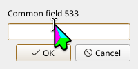
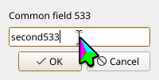
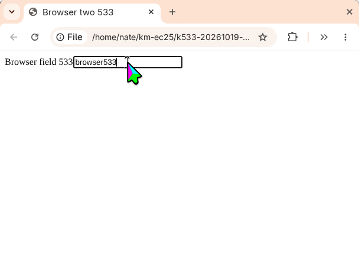

# Active-window accessibility lookup

Closes [#533](https://github.com/nm-z/kwin-mcp/issues/533).

`find_ui_elements` previously searched every accessible application or every CDP page without naming a matched window. The native baseline returned four label/field matches from two dialogs, although input would target only the active window.

The lookup now binds to one accessibility frame using the active KWin window's caption and observed geometry. It returns that window's identity, the accessibility frame and node identities, the reported accessibility coordinate frame, and bounds converted into screenshot/client pixels. If the active window changes during the lookup, the result is rejected. Missing or ambiguous frames produce an actionable error; time-limited partial results are explicitly marked incomplete.

## Coordinate observations

The real sessions exposed two different Wayland forms for AT-SPI Screen extents:

| Application | Reported frame | Conversion into client pixels |
| --- | --- | --- |
| KDialog | Client-local, even with a nonzero KWin screen origin | Use the matched client frame origin; do not subtract the screen origin twice |
| Chrome | Local buffer bounds including shadows | Include the measured buffer-to-client offset; this run used x=-16, y=-10 |

KWin distinguishes [buffer geometry and client geometry](https://develop.kde.org/docs/plasma/kwin/api/). Buffer geometry can include invisible client-side shadows. The conversion uses these observed rectangles, without hard-coding the Chrome offset.

## Real-system verification

Host: engi. Baseline executable source: `05b937d1c2ce50c52b80c878e0d1c12555a3ef44`. Corrected runtime source: `7ff8e17`.

The committed Ruby probe runs the built production stdio entrypoint with a private HOME, fresh browser profiles, two KDialog windows, and two Chrome windows. A second server process forwards each lookup to the session-owning process, reproducing the reported forwarding context. The probe requires exactly one label/field pair, checks window/frame identity, clicks the returned field bounds, and verifies the entered text independently through exported dialog output or the browser clipboard.

```bash
KWIN_MCP_E2E_BASELINE=1 KWIN_MCP_TEST_TMPDIR=/home/nate/km-ec25 \
  ruby tests/find_ui_window_e2e.rb /path/to/baseline/kwin-mcp /path/to/before
KWIN_MCP_TEST_TMPDIR=/home/nate/km-ec25 \
  ruby tests/find_ui_window_e2e.rb /path/to/candidate/kwin-mcp /path/to/after
cargo clippy --bin kwin-mcp -j1
```

The baseline exposed four matches and no window identity. The corrected forwarded path returned two matches per active window; the dialogs exported `first533` and `second533`, and the browser copied `browser533`. Both production runs and Clippy exited successfully. [Verification results](verification.jsonl), [baseline lookup](before-lookup.json), [native lookup](after-native-lookup.json), and [browser lookup](after-browser-lookup.json) are retained alongside the lossless captures.

| Baseline active dialog | Corrected native field | Corrected Chrome field |
| --- | --- | --- |
|  |  |  |

Accessibility-reported visibility is retained as such; the lookup does not claim that occlusion was checked. The captures contain synthetic fixtures. Full raw stdio traces are omitted because screenshot responses include image payloads and session startup includes unrelated host metadata.
