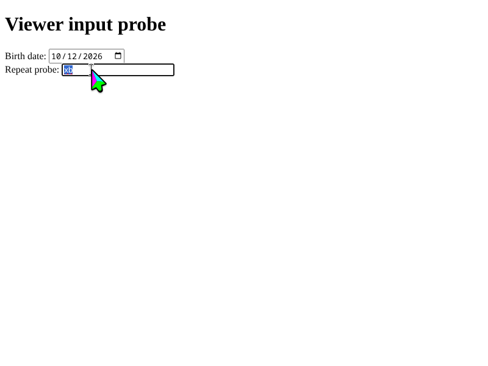

# Input delivery receipt probe

Run on a KDE desktop host with KWin, bubblewrap, pasta, input devices and Konsole.
Build the production server separately, then give each run a fresh artifact
directory. The probe creates an empty private HOME and stops its owned session
in `ensure`; no host browser profile is used.

```bash
KWIN_MCP_E2E_SERVER="$PWD/target/debug/kwin-mcp" \
KWIN_MCP_TEST_ARTIFACT_DIR="$PWD/tests/evidence/terminal" \
ruby tests/input_delivery_e2e.rb terminal
```

The terminal mode waits up to 15 seconds for the launched Konsole window to be
active and for a terminal to report focus and visibility through AT-SPI. It
requests unnamed elements explicitly: Konsole's terminal has no accessible
name. An unexpected dialog or missing focus ends the probe before shell input,
with the last window inventory, terminal tree and screenshot in the artifact
directory.

After typing the synthetic command, the probe requires an `unverified` receipt,
compositor acknowledgement, complete submission, no application text counts and
`retry_safe: false`. It then sends Return and independently exports the command's
output file, checking its exact contents.

Konsole can expose focused list items under its hidden SSH Manager panel,
including “Don't Change”, while its actual terminal also reports focus. This
does not establish a first-run dialog. The terminal does not report `Editable`,
so receipt discovery must recognize its role independently of that state.

To verify that a real covering dialog prevents the preflight from proceeding,
run this separate mode (also requires `kdialog`):

```bash
KWIN_MCP_E2E_SERVER="$PWD/target/debug/kwin-mcp" \
KWIN_MCP_TEST_ARTIFACT_DIR="$PWD/tests/evidence/terminal-blocked" \
ruby tests/input_delivery_e2e.rb terminal_blocked
```

This mode opens a synthetic message dialog and expects the focus wait to time
out without any `keyboard_type` or `keyboard_key` call. Both modes log their
production stdio requests and responses in `rpc.jsonl`.

## Accelerated terminal command (#476)

```bash
KWIN_MCP_E2E_SERVER="$PWD/target/debug/kwin-mcp" \
KWIN_MCP_TEST_ARTIFACT_DIR="$PWD/tests/evidence/terminal-fast" \
ruby tests/input_delivery_e2e.rb terminal_fast
```

This mode uses a 1920×1080 desktop and the same terminal-focus preflight. It
types exactly 120 ASCII characters at `speed: 4`, including a final newline,
and requires the complete RPC to finish within ten seconds. It checks the
unverified application-text receipt separately from acknowledged, complete
submission, waits for the command's output file, and independently exports and
compares its exact bytes. The private `/tmp` output is synthetic and the command
does not touch user files. Artifacts retain the request, exported output,
timing/receipt JSON, screenshots, and full stdio responses.

## Cleared composer after Delete (#288)

Build the production server, then run this mode in a new artifact directory:

```bash
cargo build --release --bin kwin-mcp
KWIN_MCP_E2E_SERVER="$PWD/target/release/kwin-mcp" \
KWIN_MCP_TEST_ARTIFACT_DIR="$PWD/tests/evidence/clear-retype" \
ruby tests/input_delivery_e2e.rb clear_retype
```

The mode starts an isolated 1920×1080 desktop, launches the ChatGPT Electron
executable with a private profile, and installs a static synthetic document with
CDP. It clicks the composer, types 250 ASCII characters, captures immediately,
then copies and checks the exact field text through the session clipboard. It
clears with Ctrl+A/Delete, captures the empty composer, retypes the same text,
and repeats the checks. The clipboard sentinel prevents an old selection from
passing a new copy check. A separate textarea case types after a real Return and
verifies that its leading newline is retained.

After Delete, Electron may remove the accessible blank-line placeholder when
typing. In that case the receipt reports `unverified` with
`atspi_transformed_blank_line`, preserving the original 251 expected / 250
observed counts and the inspection/no-blind-retry warning. The probe still
requires the independent copy to match all 250 requested bytes. A real newline
retained by the field must remain normally verified. The mode saves PNGs,
copied values, accessibility snapshots and MCP responses, and its `ensure`
block stops the owned session.
## Viewer input priority

The Rust lifecycle case
`viewer_input_only_pauses_agent_input_for_the_recent_quiet_period` also verifies
viewer priority using an isolated outer desktop. It types into the viewer while
screenshots run, checks local and remote quiet periods and held-key repeat, and
interrupts an admitted 300-character agent operation with a viewer keystroke.
The interruption must return promptly with `retry_safe: false`; copying the
field independently must show the viewer character and only part of the agent
text. No user desktop input is generated by this test.

Latest integrated capture after viewer `b` interrupted the first agent `x`
(the requested agent text was 300 characters):


