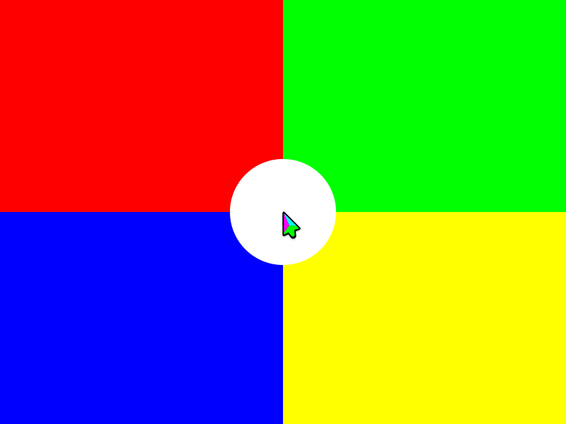
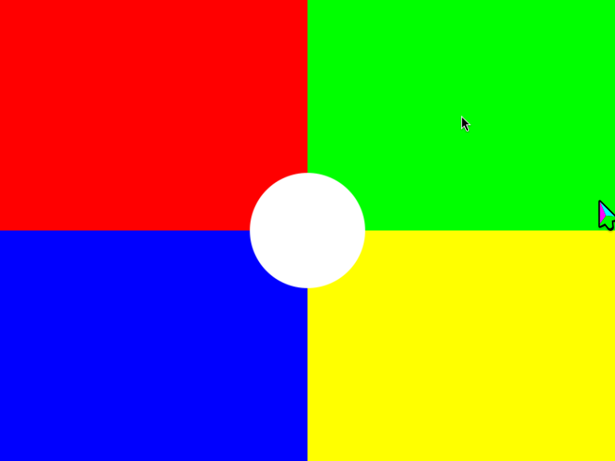

# Viewer resize and input regression

`viewer_resize_e2e.rb` drives the production `kwin-mcp` stdio entrypoint. It starts an outer isolated desktop for the viewer and an inner isolated session containing a full-screen C GTK test application. Both sessions use empty private homes. Host browser profiles and host windows are outside this test.

## Build

On the currently authorized build host, use an owned source and target directory and the team’s current CPU/memory policy:

```bash
CARGO_BUILD_JOBS=2 CARGO_PROFILE_DEV_DEBUG=0 CARGO_PROFILE_DEV_INCREMENTAL=false \
  CARGO_TARGET_DIR=/path/to/private-target cargo build --locked --bins
bash tests/build_viewer_fixtures.sh /path/to/private-fixtures
```

The fixtures require GTK 4, Wayland client development files, `wayland-scanner`, and the Plasma `fake-input.xml` protocol. They use the system XML, falling back to the already-locked `wayland-protocols-plasma` Cargo dependency. Set `KWIN_MCP_FAKE_INPUT_XML` to use another private copy.

Copy `kwin-mcp`, `kwin-viewer`, `viewer-input-probe`, and `viewer-touch` into one private evidence directory on engi. Keep the source script available at a path under `/home`; session `/tmp` is private.

## Run

```bash
KWIN_MCP_E2E_BIN_DIR=/path/to/private-bin \
  ruby tests/viewer_resize_e2e.rb /path/to/new-evidence-directory
```

The fixture sets `KWIN_MCP_TEST_RESIZABLE_WINDOWS=1` only on its outer server to omit that session’s forced-maximize rule. Normal sessions keep their existing window rule. It can also use a short writable host path supplied as `KWIN_MCP_E2E_TMPDIR` for each server’s `TMPDIR`; this avoids Unix-socket path limits and lets the run avoid a full `/tmp` quota. It supplies `/run/user/<uid>` and its D-Bus address to each private server, and `viewer_open` receives the outer isolated Wayland socket.

The inner server sets `KWIN_MCP_TEST_TOUCH_LOG=1` so `viewer.log` records the touch phases and positions for this regression. Normal viewer runs do not log touch coordinates.

The runtime also needs `ruby` and ImageMagick `magick` on the KDE host. The test performs these real operations:

1. `session_start` for each production stdio server, then `launch_app` and `viewer_open` for the inner session.
2. Drag the viewer’s bottom edge, then a horizontal edge, through real Meta+right-button input in the outer isolated KWin.
3. Query the resulting geometry through `window_list`, capture through `screenshot`, and verify all four picture corners contain the expected colors, with no bars.
4. Click through the outer session’s `mouse_click` at a known viewer position. A persistent authenticated fake-input client is connected before the viewer opens so its Wayland seat advertises touch; send touch down/up sequences through that protocol after each resize. Verify the C application in the inner session received the expected pixels within two pixels.
5. Export the application events and viewer log, then call `session_stop` on both sessions.

Evidence includes JSON-RPC logs, requested and resulting geometry, a before-resize screenshot and screenshots after both resizes, source application click coordinates, viewer resize requests and the sizes returned by `request_inner_size`.

The normal result requires the same 4:3 ratio as the 800×600 session after both resizes, within one pixel of integer rounding. Under #250’s compositor exception, a differing ratio is reported as a limitation only when the viewer log shows `request_inner_size` returning exactly that measured, uncorrected geometry. Input and corner-color assertions still must pass. A mismatch without that evidence fails the test.

## Example evidence

These screenshots and logs come from a real run of the production stdio servers. The window starts at 800×600, then finishes at 667×500 after a vertical drag and 767×575 after a horizontal drag. The corner-color checks passed at both sizes; the input log records mouse pixels near (200, 450) and touch pixels at (600, 150) in the 800×600 session.

### Before resize



### After vertical drag


### After horizontal drag



The matching [geometry](evidence/viewer-resize-geometry.json), [viewer log](evidence/viewer-resize.log), and [received input pixels](evidence/viewer-resize-inputs.txt) preserve the request results and pixel positions.
