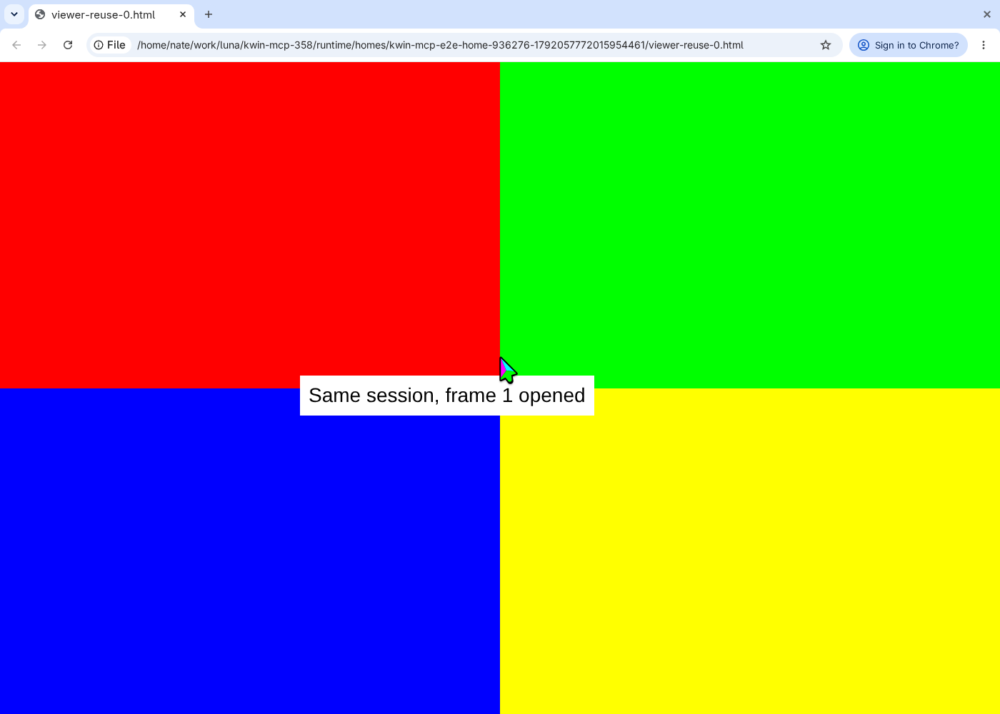
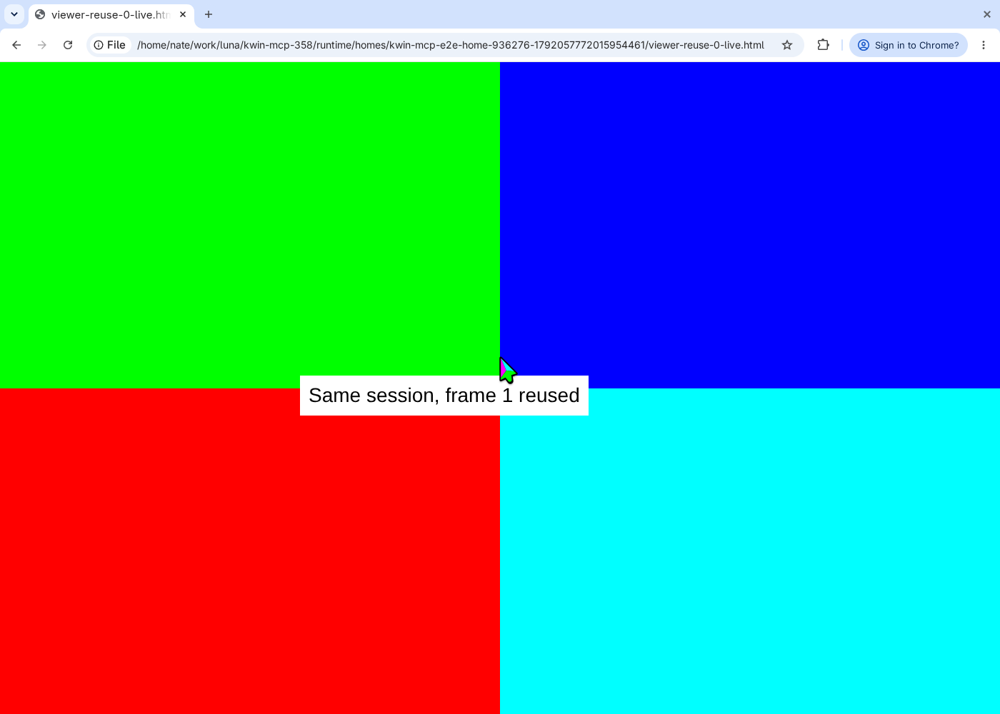
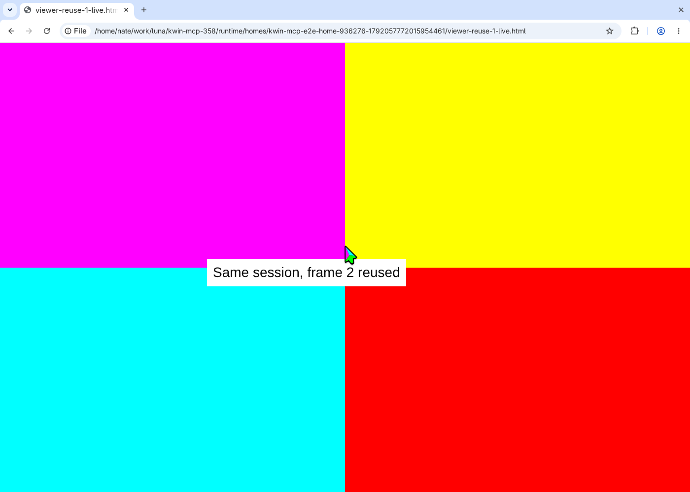

# Viewer reuse and reopen regression (#358)

`viewer_reuses_and_reopens_after_presenting_a_frame` drives the production MCP
stdio server. It starts an outer isolated KWin desktop as the viewer's display
and one 1400×1000 source desktop with a fresh Chrome profile and local HTML.
It verifies the actual outer compositor pixels, viewer PID/window identity,
title changes, and browser window continuity through two open/reuse/close
rounds. The first round closes the actual viewer window through the outer desktop using Alt+F4; the second uses viewer_close. Each reuse navigates the live browser to a different palette; the
second open must create a new viewer in the same source session.

Requires KDE Plasma 6, bubblewrap, PipeWire, Google Chrome, input-device access,
and Vulkan rendering. A software Vulkan driver can be selected with
`VK_DRIVER_FILES`; `LIBGL_ALWAYS_SOFTWARE=1` selects software OpenGL.
The filtered bus below permits systemd session scopes while hiding host wallet
services. Both servers use private HOME directories. Keep `KWIN_MCP_TEST_TMPDIR` (if
overridden) outside `/tmp`, which is replaced inside each sandbox.

Run from the repository after building both binaries:

```bash
probe_dir=$(mktemp -d)
xdg-dbus-proxy "unix:path=/run/user/$(id -u)/bus" "$probe_dir/bus" \
  --filter --talk=org.freedesktop.systemd1 &
proxy_pid=$!
trap 'kill "$proxy_pid"; wait "$proxy_pid"; rm -rf "$probe_dir"' EXIT
for attempt in {1..50}; do
  [ -S "$probe_dir/bus" ] && break
  sleep 0.1
done
env KWIN_MCP_E2E=1 \
  KWIN_MCP_TEST_DBUS_SESSION_BUS_ADDRESS="unix:path=$probe_dir/bus" \
  KWIN_MCP_TEST_ARTIFACT_DIR="$PWD/tests/evidence/viewer-reuse" \
  /home/nate/claude/luna/build-slot cargo test --locked --jobs 1 \
  --test session_lifecycle_e2e viewer_reuses_and_reopens_after_presenting_a_frame \
  -- --ignored --exact --nocapture
```

Artifacts include the opened and reused viewer screenshots from each round.
These capture transitions on the fixed build, not a comparison with the old
renderer. The check does not exercise an existing browser profile, remote SSH
viewing, authentication. Window-manager closure is exercised inside the isolated outer desktop.

## Captured transitions

These are outer compositor captures from the passing #358 run. The first and
second images retain the same viewer process/window; the third follows a
close/reopen in that same source session and another live content update.




